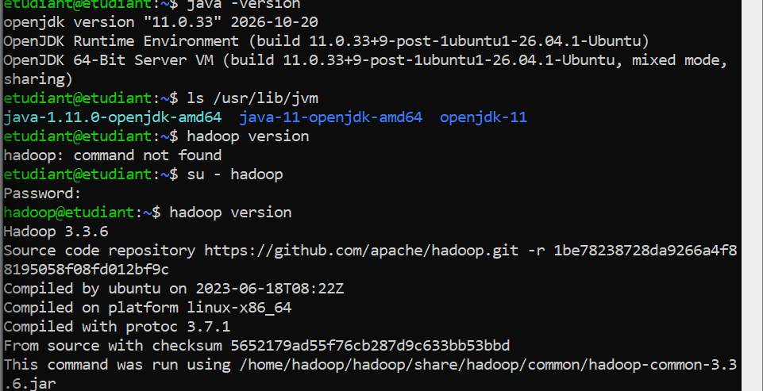
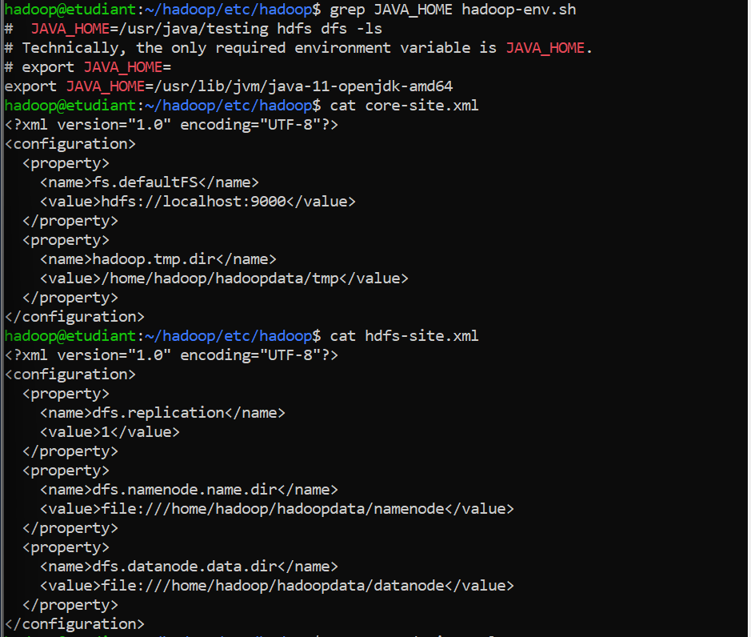
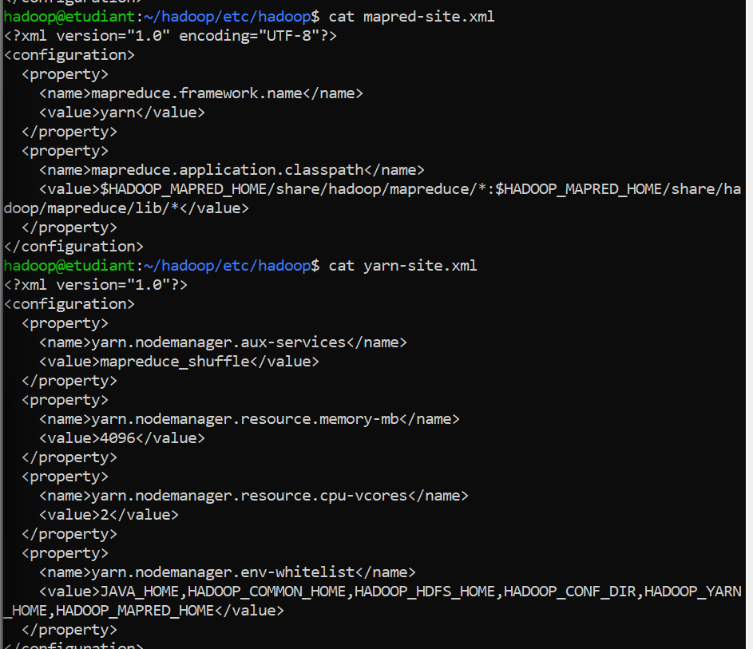
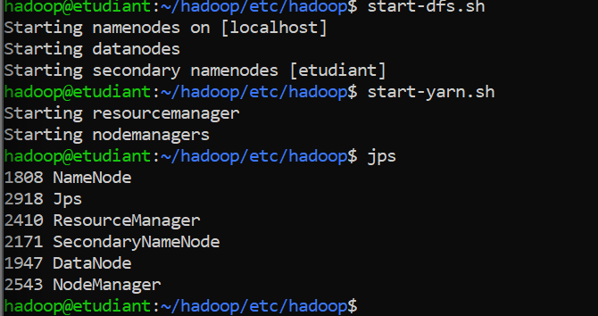
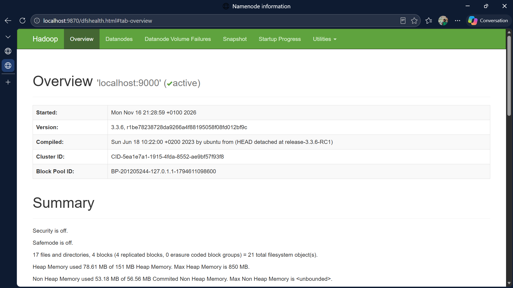
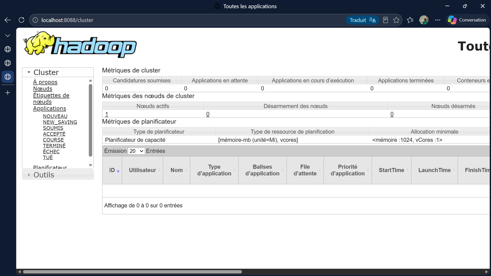
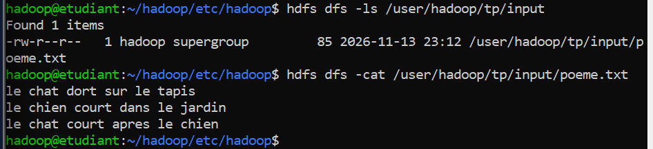
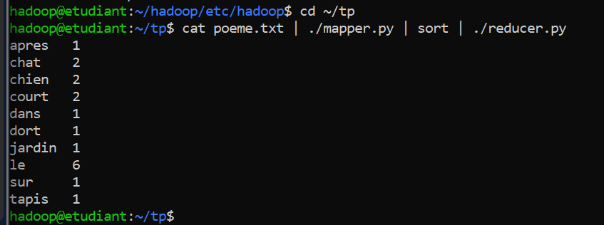
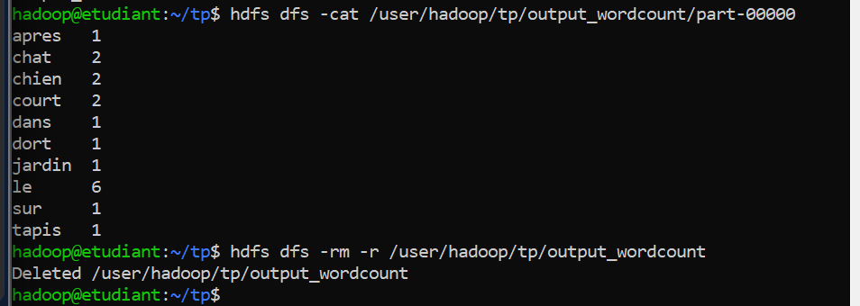

# Compte rendu de TP : Hadoop sous Ubuntu et MapReduce avec Python

**Date :** 16 novembre 2026
**Thème :** installation et configuration de Hadoop en mode pseudo-distribué, manipulation de HDFS et traitement MapReduce avec Python (Hadoop Streaming)

---

## 1. Objectifs

- Comprendre le principe d'un cluster informatique et l'architecture de Hadoop (HDFS pour le stockage, YARN pour la gestion des ressources).
- Installer et configurer Hadoop 3.3.6 sous Ubuntu en mode pseudo-distribué.
- Démarrer les services HDFS et YARN et les superviser avec les interfaces web.
- Stocker un fichier dans HDFS.
- Réaliser un comptage de mots (*word count*) avec MapReduce, en Python, via Hadoop Streaming.

## 2. Environnement

| Élément | Valeur |
|---|---|
| Système | Ubuntu (machine virtuelle, hôte `etudiant`) |
| Java | OpenJDK 11.0.33 (`/usr/lib/jvm/java-11-openjdk-amd64`) |
| Hadoop | 3.3.6, installé dans `/home/hadoop/hadoop` |
| Utilisateurs | `etudiant` (administration) et `hadoop` (exécution des services) |
| Mode | Pseudo-distribué : tous les services sur une seule machine |

## 3. Préparation du système

### 3.1 Installation des dépendances

```bash
sudo apt update && sudo apt upgrade -y
sudo apt install -y openjdk-11-jdk ssh pdsh wget python3
java -version
ls /usr/lib/jvm
```

Java est indispensable, car Hadoop est écrit en Java. La commande `java -version` affiche OpenJDK 11.0.33, et `ls /usr/lib/jvm` confirme la présence de `java-11-openjdk-amd64`, chemin utilisé ensuite pour `JAVA_HOME`.

### 3.2 Utilisateur dédié et SSH

```bash
sudo adduser hadoop
sudo usermod -aG sudo hadoop
su - hadoop

ssh-keygen -t rsa -P '' -f ~/.ssh/id_rsa
cat ~/.ssh/id_rsa.pub >> ~/.ssh/authorized_keys
chmod 0600 ~/.ssh/authorized_keys
ssh localhost
exit
```

L'utilisateur `hadoop` sépare les services Hadoop de l'utilisateur principal. La connexion SSH sans mot de passe est nécessaire parce que les scripts de démarrage de Hadoop utilisent SSH, même sur une seule machine.

## 4. Installation de Hadoop

```bash
cd ~
wget https://archive.apache.org/dist/hadoop/common/hadoop-3.3.6/hadoop-3.3.6.tar.gz
tar -xzf hadoop-3.3.6.tar.gz
mv hadoop-3.3.6 hadoop
```

### Variables d'environnement

Ajoutées à `~/.bashrc`, puis rechargées avec `source ~/.bashrc` :

```bash
export JAVA_HOME=/usr/lib/jvm/java-11-openjdk-amd64
export HADOOP_HOME=$HOME/hadoop
export HADOOP_CONF_DIR=$HADOOP_HOME/etc/hadoop
export HADOOP_MAPRED_HOME=$HADOOP_HOME
export HADOOP_COMMON_HOME=$HADOOP_HOME
export HADOOP_HDFS_HOME=$HADOOP_HOME
export HADOOP_YARN_HOME=$HADOOP_HOME
export PDSH_RCMD_TYPE=ssh
export PATH=$PATH:$HADOOP_HOME/bin:$HADOOP_HOME/sbin
```

### Vérification



**Observations :**
- `java -version` affiche OpenJDK 11.0.33, et `ls /usr/lib/jvm` liste `java-11-openjdk-amd64`.
- `hadoop version` donne `command not found` avec l'utilisateur `etudiant`. C'est normal : les variables d'environnement ont été ajoutées au `.bashrc` de l'utilisateur `hadoop` uniquement.
- Après `su - hadoop`, la commande affiche **Hadoop 3.3.6**, ce qui confirme l'installation.

## 5. Configuration de Hadoop

Les fichiers se trouvent dans `$HADOOP_HOME/etc/hadoop`.

| Fichier | Rôle | Paramètres principaux |
|---|---|---|
| `hadoop-env.sh` | Emplacement de Java | `JAVA_HOME=/usr/lib/jvm/java-11-openjdk-amd64` |
| `core-site.xml` | Système de fichiers par défaut | `fs.defaultFS = hdfs://localhost:9000`, `hadoop.tmp.dir = /home/hadoop/hadoopdata/tmp` |
| `hdfs-site.xml` | HDFS | `dfs.replication = 1`, dossiers du NameNode et du DataNode dans `/home/hadoop/hadoopdata/` |
| `mapred-site.xml` | MapReduce | `mapreduce.framework.name = yarn`, classpath MapReduce |
| `yarn-site.xml` | YARN | `mapreduce_shuffle`, 4096 Mo de mémoire et 2 cœurs pour le NodeManager |





**Observations :**
- La réplication est fixée à **1**, car il n'y a qu'un seul DataNode.
- HDFS est accessible à l'adresse `hdfs://localhost:9000`.
- MapReduce s'exécute sur YARN, qui fournit le service de *shuffle* aux tâches.

## 6. Formatage et démarrage du cluster

```bash
mkdir -p ~/hadoopdata/{namenode,datanode,tmp}
hdfs namenode -format
start-dfs.sh
start-yarn.sh
jps
```

Le formatage du NameNode ne se fait **qu'une seule fois**, lors de la première installation.



**Observations :** `start-dfs.sh` démarre le NameNode, le DataNode et le SecondaryNameNode, et `start-yarn.sh` démarre le ResourceManager et le NodeManager. La commande `jps` liste bien les cinq processus attendus :

| Processus | PID | Rôle |
|---|---|---|
| NameNode | 1808 | Gère les métadonnées de HDFS |
| DataNode | 1947 | Stocke les blocs de données |
| SecondaryNameNode | 2171 | Aide le NameNode pour les points de contrôle |
| ResourceManager | 2410 | Répartit les ressources du cluster (YARN) |
| NodeManager | 2543 | Exécute les conteneurs sur le nœud (YARN) |

## 7. Interfaces web

### 7.1 HDFS : `http://localhost:9870`



L'onglet *Overview* indique que le NameNode `localhost:9000` est **active**. On y relève :
- version 3.3.6 ;
- *Security is off* et *Safemode is off* : HDFS est prêt à lire et à écrire ;
- 17 fichiers et répertoires, 4 blocs, soit 21 objets au total ;
- mémoire *heap* utilisée : 78,61 Mo sur 151 Mo.

### 7.2 YARN : `http://localhost:8088`



L'interface (traduite en français par le navigateur) montre **1 nœud actif**, aucun nœud désarmé, et le planificateur de capacité (*Capacity Scheduler*) avec une allocation minimale de 1024 Mo et 1 vCore. Aucune application n'apparaît sur cette capture, prise avant le lancement du traitement.

## 8. Manipulation de HDFS

```bash
hdfs dfs -mkdir -p /user/hadoop/tp/input
mkdir -p ~/tp && cd ~/tp
cat > poeme.txt << 'EOF'
le chat dort sur le tapis
le chien court dans le jardin
le chat court apres le chien
EOF
hdfs dfs -put poeme.txt /user/hadoop/tp/input/
hdfs dfs -ls /user/hadoop/tp/input
hdfs dfs -cat /user/hadoop/tp/input/poeme.txt
```



**Observations :**
- `hdfs dfs -ls` affiche un fichier, `poeme.txt`, de **85 octets**, avec un facteur de réplication de **1**, propriétaire `hadoop` et groupe `supergroup`.
- `hdfs dfs -cat` affiche les trois lignes du texte : le fichier est bien stocké dans HDFS.

## 9. Traitement MapReduce avec Python

### 9.1 Principe

MapReduce se déroule en plusieurs phases :

```
Input → Map → Shuffle and Sort → Reduce → Output
```

- **Input** : Hadoop découpe les données en fragments.
- **Map** : chaque ligne est transformée en paires clé-valeur `(mot, 1)`.
- **Shuffle and Sort** : les paires sont regroupées et triées par clé.
- **Reduce** : les valeurs de chaque mot sont additionnées.
- **Output** : le résultat est écrit dans HDFS.

### 9.2 Le Mapper (`mapper.py`)

```python
#!/usr/bin/env python3
import sys
import re
for ligne in sys.stdin:
    ligne = ligne.strip().lower()
    mots = re.findall(r"[a-zàâäéèêëîïôöùûüç]+", ligne)
    for mot in mots:
        print(f"{mot}\t1")
```

Le Mapper lit le texte, extrait les mots (en minuscules) et affiche chaque mot suivi de la valeur 1.

### 9.3 Le Reducer (`reducer.py`)

```python
#!/usr/bin/env python3
import sys
mot_courant = None
total = 0
for ligne in sys.stdin:
    mot, valeur = ligne.rstrip("\n").split("\t", 1)
    valeur = int(valeur)
    if mot == mot_courant:
        total += valeur
    else:
        if mot_courant is not None:
            print(f"{mot_courant}\t{total}")
        mot_courant = mot
        total = valeur
if mot_courant is not None:
    print(f"{mot_courant}\t{total}")
```

Le Reducer reçoit les lignes triées, regroupe les mots identiques et additionne leurs valeurs.

### 9.4 Test en local

```bash
chmod +x mapper.py reducer.py
cat poeme.txt | ./mapper.py | sort | ./reducer.py
```



Le tube Unix simule le fonctionnement de MapReduce : `sort` joue le rôle de la phase *Shuffle and Sort*. Le résultat est correct, ce qui valide les deux programmes avant de les lancer sur Hadoop.

### 9.5 Exécution avec Hadoop Streaming

```bash
hadoop jar $HADOOP_HOME/share/hadoop/tools/lib/hadoop-streaming-3.3.6.jar \
-files mapper.py,reducer.py \
-mapper "python3 mapper.py" \
-reducer "python3 reducer.py" \
-input /user/hadoop/tp/input \
-output /user/hadoop/tp/output_wordcount
```

Hadoop Streaming exécute les scripts Python comme Mapper et Reducer. Le fichier d'entrée est lu dans HDFS et le résultat est écrit dans le dossier de sortie.

### 9.6 Résultat

```bash
hdfs dfs -cat /user/hadoop/tp/output_wordcount/part-00000
```



| Mot | Occurrences |
|---|---|
| apres | 1 |
| chat | 2 |
| chien | 2 |
| court | 2 |
| dans | 1 |
| dort | 1 |
| jardin | 1 |
| le | 6 |
| sur | 1 |
| tapis | 1 |

Le résultat obtenu avec Hadoop est **identique** à celui du test local. Le mot « le » est le plus fréquent (6 occurrences), et le texte contient 10 mots distincts pour 17 mots au total.

Pour relancer le traitement, il faut d'abord supprimer le dossier de sortie, car Hadoop refuse d'écrire dans un dossier existant :

```bash
hdfs dfs -rm -r /user/hadoop/tp/output_wordcount
```

La dernière capture montre cette suppression (`Deleted /user/hadoop/tp/output_wordcount`).

## 10. Difficultés et remarques

- La commande `hadoop` n'est pas reconnue avec l'utilisateur `etudiant`, car les variables d'environnement sont définies pour l'utilisateur `hadoop`. Il faut donc travailler avec `su - hadoop`.
- Le formatage du NameNode (`hdfs namenode -format`) ne doit être fait qu'à la première installation, sous peine de perdre les données de HDFS.
- Hadoop refuse d'écrire dans un dossier de sortie qui existe déjà : il faut le supprimer avant chaque nouvelle exécution.
- Tester le Mapper et le Reducer en local avec un tube Unix permet de détecter les erreurs avant de lancer le traitement sur le cluster.

## 11. Conclusion

Ce TP a permis d'installer et de configurer Hadoop 3.3.6 en mode pseudo-distribué sous Ubuntu, de démarrer les services HDFS et YARN et de les superviser par leurs interfaces web. Nous avons stocké un fichier dans HDFS, puis réalisé un comptage de mots avec MapReduce en Python grâce à Hadoop Streaming. Le résultat est conforme au test local : ce TP illustre les principes du stockage et du traitement distribué des données.
